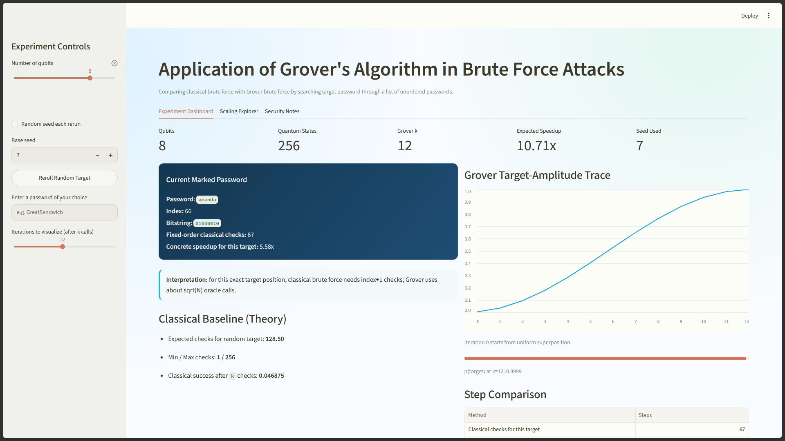
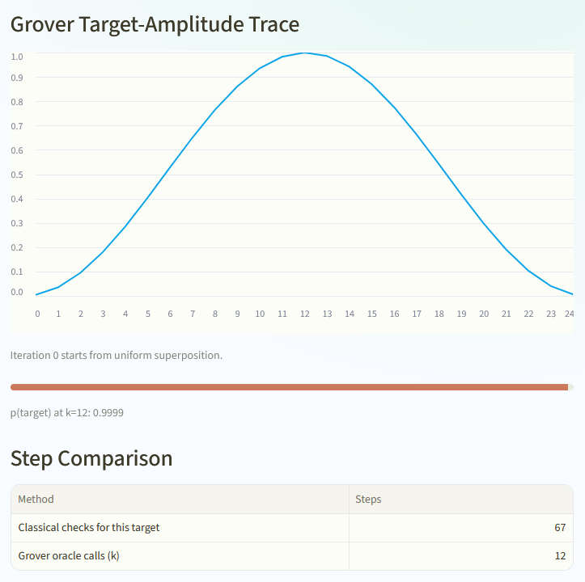

# Grover's Algorithm in Brute-Force Attacks

An interactive Streamlit app that compares **classical brute-force search** with **Grover's quantum search algorithm** when looking for a target password in an unordered list. Built with [Qiskit](https://www.ibm.com/quantum/qiskit) for the Quantum Ready program.

**[Live demo](https://grover-brute-force-search.streamlit.app/)** · **[Screenshots](#screenshots)**


## What it does

- Builds a real Grover circuit (oracle + diffuser) in Qiskit for 2 to 10 qubits, i.e. a search space of up to 1,024 passwords taken from a list of common passwords.
- Simulates the circuit with Qiskit's `Statevector` and plots the probability of measuring the target after each Grover iteration.
- Compares the number of classical checks (O(N)) against Grover oracle calls (about O(√N)) for the chosen target.
- Includes a scaling explorer and a short security discussion of what Grover means for symmetric key sizes.

> **Note:** the quantum algorithm runs on a classical simulator, so all comparisons count *oracle calls and checks*, not wall-clock time.

## Screenshots

### Experiment dashboard


### Grover iterations at the maximum setting


## Run it locally

Requires Python 3.10+.

```powershell
git clone https://github.com/YOUR_USERNAME/YOUR_REPO.git
cd YOUR_REPO
python -m venv .venv
.venv\Scripts\Activate.ps1
pip install -r requirements.txt
streamlit run streamlit_app.py
```

On macOS/Linux, activate with `source .venv/bin/activate` instead.

## How it works

1. Start with a uniform superposition over all N = 2ⁿ password indices.
2. The **oracle** flips the phase of the target index.
3. The **diffuser** reflects amplitudes about the mean, boosting the target.
4. Repeat about ⌊(π/4)·√N⌋ times, then measure.

## Project structure

```
streamlit_app.py          # app and Grover circuit code
10k-common-passwords.txt  # password list used as the search space
.streamlit/config.toml    # Streamlit theme
static/                   # custom fonts referenced by the theme
requirements.txt
```

## Team

Built during the 10-week Quantum Ready program by:

- Aryan Karayi ([@github](https://github.com/aryankarayi))
- Sami Nadweh ([@github](https://github.com/sami22345))
- Fabio Castro ([@github](https://github.com/FabioCastroMorffi))
- Evan Hinojosa ([@github](https://github.com/Farbirb))

## License

MIT, see [LICENSE](LICENSE).
